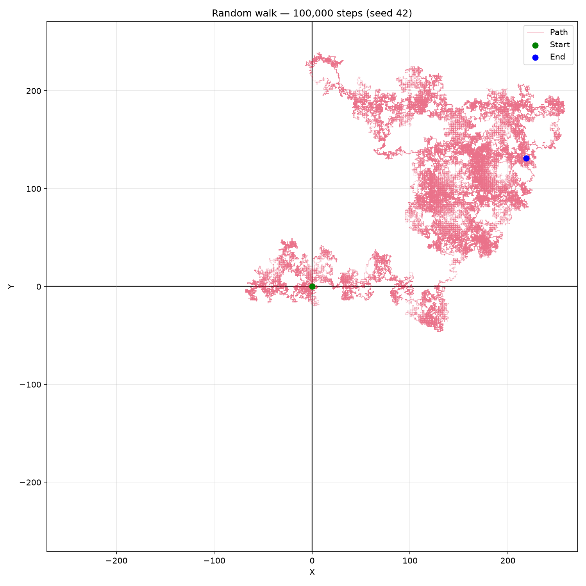

# Random walk of a particle

[](https://www.python.org/)
[](https://numpy.org/)
[](https://matplotlib.org/)

A 2D random walk simulator, written to do more than "draw a squiggle": it
**shows the √N law of diffusion** — after `N` unit steps a particle typically
ends up only about `√N` units away from where it started, not `N`. The run is
fully reproducible with a single seed, persisted as JSON, and rendered as a
plot where the origin sits exactly at the center.

---

## Table of contents

- [Why](#why)
- [How it works](#how-it-works)
- [What it demonstrates](#what-it-demonstrates)
- [Results](#results)
- [Installation](#installation)
- [Usage](#usage)
- [Project structure](#project-structure)
- [Key takeaways](#key-takeaways)

---

## Why

The rule could not be simpler: a particle starts at `(0, 0)` and, at each
step, moves one unit **up, down, left or right**, each with probability 1/4.

That simple rule is one of the most used models in science: diffusion of
molecules (Einstein's 1905 paper), the shape of polymers, the foraging paths
of animals, and the "drunkard's walk" behind many financial models.

Most implementations stop at drawing the path. This project answers the
interesting question: **how far does the particle actually get?**

The answer — the **√N law** — is counterintuitive: to double the distance
from the origin you need *four times* the steps. A walk of 10,000 steps
lands, typically, only ~100 units away. Random movement is an extremely
inefficient way to travel, and that is exactly why diffusion is slow and
cells need molecular motors to transport cargo.

---

## How it works

1. **Sampling.** The `steps` displacements are drawn in one vectorized call
   to `np.random.Generator.choice()` over the four unit vectors:

   ```text
   (0, +1)   (0, -1)   (+1, 0)   (-1, 0)
   ```

2. **Accumulation.** Each displacement is added to the current position and
   appended to a list in which **the index *is* the step number**: element 0
   is the origin, element `k` is the position after step `k`. A run of `N`
   steps therefore stores `N + 1` points, and JSON arrays preserve that order
   by specification.

3. **Reproducibility.** The seed feeds `np.random.default_rng(seed)`, so the
   same seed always produces the *same* walk. If no seed is given, one is
   generated and printed so the experiment can always be repeated later.

4. **Persistence.** With `--save`, the run is written to
   `results/walking_results.json` as `{"steps", "seed", "path"}`, where
   `path` is the ordered list of `{"x", "y"}` positions.

5. **A memory guard.** Every step costs ≈ 250 bytes (measured with
   `tracemalloc`, rounded up). Before allocating anything, the program
   estimates the memory and refuses to run above **1.5 GB** — i.e. more than
   6,000,000 steps — unless you pass `--force`.

6. **Presentation.** `plot_results.py` reads the JSON and renders
   `img/particle_path.png`: an equal aspect ratio so unit steps look like
   units, symmetric limits so the **origin sits at the exact center**, black
   axes crossing at `(0, 0)` to stand out from the grey grid, and green/blue
   markers for the start and the end of the walk.

---

## What it demonstrates

| Concept | Where |
| --- | --- |
| 2D simple symmetric random walk | `random_walk()` |
| The √N law of diffusion | spreading of the path in the plot |
| Reproducibility via a random seed | `--seed`, `default_rng()` |
| Defensive input validation | `positive_integer()`, `non_negative_integer()` |
| A memory guard before allocating GBs of RAM | `BYTES_PER_STEP`, `--force` |
| Interactive CLI that fills in missing values | `fill_missing()` |
| Ordered data structure as the natural model of a walk | `step_list` (index = step) |
| JSON persistence of the full trajectory | `save_json()` |
| Separation of computation / persistence / presentation | module sections |
| Presentation decoupled from simulation | `plot_results.py` |

---

## Results

Run the simulation and generate the plot:

```bash
python3 random_walk.py --steps 100000 --seed 42 --save
python3 plot_results.py
```

### The path of the particle

A hundred thousand unit steps from a fixed seed. The black lines cross at
the origin, the green dot is where the walk started and the blue dot where
it ended — note how far the particle traveled *in steps* (100,000) versus
*in distance* (it never leaves a box of ±260):



Because the run is seeded, the figure above is exactly what those two
commands reproduce.

Representative console output:

```console
  Simulation of a particle's random walk.
  Seed: 42
  The results were saved in 'results/walking_results.json'
  To generate the plot, run:
    python3 plot_results.py

  The plot was saved in 'img/particle_path.png'

  The plot is located in 'img/' and is version-controlled for the README.
```

---

## Installation

Requires **Python 3.10+**.

```bash
git clone https://github.com/rymi14/random-walk
cd random_walk

python3 -m venv .venv
source .venv/bin/activate
pip install -r requirements.txt
```

---

## Usage

Run it with no arguments for an interactive session that explains each
parameter as it asks, or pass everything explicitly:

```bash
# Interactive mode (guides you through every option)
python3 random_walk.py

# 10,000 steps with a fixed seed, saved to results/
python3 random_walk.py --steps 10000 --seed 42 --save

# A quick run without saving anything
python3 random_walk.py --steps 500

# Generate the plot from the saved results
python3 plot_results.py
```

### Command-line options

| Option | Description | Default |
| --- | --- | --- |
| `--steps STEPS` | Unit steps the particle will take (must be positive) | `10000` |
| `--seed S` | Non-negative seed for reproducible results | random |
| `-s, --save` | Save the results as JSON in `results/` | off |
| `--force` | Bypass the 1.5 GB memory safety limit (max 6,000,000 steps) | off |

---

## Project structure

```text
random_walk/
├── README.md          # This file
├── random_walk.py     # Simulation, CLI, memory guard, and JSON persistence
├── plot_results.py    # Chart from the saved JSON (particle path)
├── requirements.txt   # numpy, matplotlib
├── .gitignore         # Ignores results/, .venv/ and __pycache__/
├── results/           # Generated JSON (git-ignored)
└── img/               # Generated PNGs (versioned for this README)
```

The code is organized in clear sections — exceptions, data entry, walking
calculation, persistence, and CLI — so each part can be read and modified
independently.

---

## Key takeaways

- **Diffusion is slow.** Distance grows as `√N`, not `N`: 100× more steps
  buy only 10× more ground. That is the √N law in practice.
- **Reproducibility is cheap.** A single `--seed` reproduces the whole
  walk — and the README figure — exactly.
- **The data structure should match the model.** Storing the path as a list
  where *the index is the step number* removes any need for bookkeeping, and
  JSON arrays are ordered by specification.
- **Guard resources before allocating them.** A 250 B/step estimate catches
  a runaway `--steps` value before it consumes gigabytes of RAM.
- **Keep computation, persistence and presentation apart.** The simulator
  knows nothing about matplotlib, and the plotter knows nothing about how
  the walk was generated.
